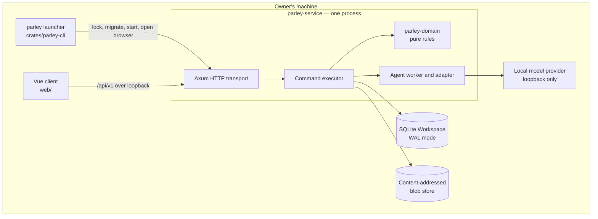
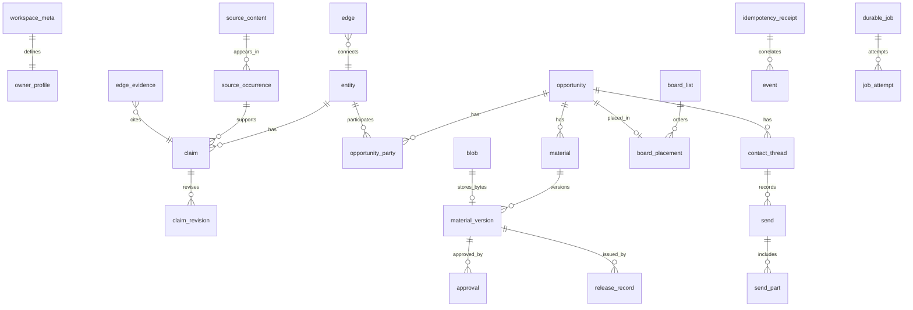

# Architecture

**Audience:** Contributors changing behavior, persistence, or the client-service boundary.
**Purpose:** Explain the boundaries, data model, and decisions behind the current code.
**Prerequisites:** Read the [glossary](README.md#glossary) and the root [README](../README.md).

## Architectural style

Parley is a layered local application.
One launcher starts one service for one Workspace.
The service is the only writer.
The browser is a client of that service.

We keep the rules deterministic and the model advisory.
A model may propose data.
Only deterministic code or an explicit Owner action changes persistent state.

The layering gives three properties:

- Rules are testable without HTTP, SQLite, or a model.
- A commit is reproducible from its inputs and its recorded event.
- Application data stays on the Owner's machine.

## System diagram

## Components

| Component | Responsibility | Depends on | Interface |
|---|---|---|---|
| `parley-cli` launcher | Find the Workspace, take the OS lock, migrate, start the service, open the browser | `parley-service` | `parley [--workspace PATH] [--headless]` and a local control socket |
| HTTP transport | Serve the same-origin static UI, enforce request limits, route API calls | Command executor | `/api/v1/*`, documented in [API](API.md) |
| Command executor | Authenticate, check revisions, replay receipts, own the write transaction | Domain, SQLx | Typed command entry point |
| `parley-domain` | Gate, lifecycle, evidence, matching, queue, and pack policy | Only serialization and Unicode libraries | Pure functions |
| Persistence | Migrations, indexed reads, events, revisions, blob references | SQLite via SQLx | SQL and migrations in `migrations/` |
| Blob store | Store immutable bytes by SHA-256 digest | Filesystem under the Workspace | Upload and release commands |
| Agent worker | Bounded adapter, durable jobs, proposal validation | Local provider on loopback | Typed run, cancel, and health operations |
| Vue client | Five tabs, editors, graph, and the development mock | Generated DTO types | One same-origin HTTP client |
| CI verifiers | Contract, migration, trace, coverage, architecture, and disk gates | Cargo metadata and fixtures | `ci/*.py` command-line flags |

## Boundary rule

The Cargo graph is restricted.
`parley-service` depends on `parley-domain`.
`parley-domain` depends on no other workspace crate.
Nothing depends on `parley-cli`.

The domain crate cannot declare HTTP, SQL, async-runtime, or CLI-parsing dependencies.
`ci/architecture.py` checks the declared graph against `ci/architecture.toml`.
`ci/trace.py` checks source-level imports.
`scripts/absent` blocks forbidden patterns in selected files.

## Data model

The diagram below is a skeleton of the main aggregates.
It shows ownership, not every column.
For column-level detail, read the migrations.

### Key invariants

- State, revision, event, and idempotency receipt commit in one transaction.
- Every mutable aggregate carries a monotone revision.
- The event log is append-only; triggers reject direct updates and deletes.
- Material versions are immutable. A correction creates a new version.
- Blobs are content-addressed. The database owns reachability.
- Notes, layout, and board order have revisions separate from semantic revisions.
- A Thread belongs to one Opportunity and one recipient.
- A Send records exact Material versions and a Gate snapshot.

Operational behavior for these tables lives in [OPERATIONS](OPERATIONS.md).

## External integrations

| Integration | Status | Boundary |
|---|---|---|
| Local model provider | Specified for loopback use | Loopback only; no hosted fallback |
| `pi` agent runner | Version pinned in `agent/` | Bounded adapter behind run, cancel, and health |
| System browser | Used by the launcher | Opened locally with a one-time bootstrap URL |
| Filesystem | Workspace, lock file, control socket, blobs | Owner-only permissions |
| Hosted services | None specified | No accounts, sync, mail, scraping, or cloud storage |

A second shell, Tauri, is specified in the RFCs.
No desktop shell is present in this tree.

## Versioning model

- The database schema version is separate from the wire version.
- Wire versioning is owned by [API](API.md#versioning).
- Config packs and role prompts are stored as immutable versions.
- Settings select one active version per role.
- A change to a prompt or pack does not rewrite historical records.

## Decisions

### ADR-1 · Pure domain core

**Context:** The same rules must hold in the browser shell, the launcher, and tests.
Model output must not change stored facts by itself.

**Decision:** We decided to keep gates, lifecycle, matching, and evidence checks in `parley-domain`.
That crate has no HTTP, SQL, file IO, or model calls.

**Consequences:** Rules are testable in isolation.
CI enforces the dependency boundary.
New domain code cannot reach persistence directly.

### ADR-2 · Single writer with receipts

**Context:** A lost acknowledgement must not create a second effect.
Stale writes must not overwrite newer state.

**Decision:** We decided to commit state, revision, event, and idempotency receipt in one SQLite transaction.
Updates require an expected revision.

**Consequences:** A replay returns one committed effect.
A stale precondition conflicts.
Transactions stay short to avoid blocking readers.

### ADR-3 · Loopback HTTP with bootstrap session

**Context:** There is one Owner and no account system.
Both shells must trust the same service instance.

**Decision:** We decided to serve the UI and API from one loopback origin.
A one-time bootstrap secret establishes a local session with a mutation token.

**Consequences:** One service instance owns each Workspace.
A second launch reuses it.
No remote authentication or broad CORS is needed.

### ADR-4 · Independent mock with contract parity

**Context:** Frontend work should not require Rust, SQLite, or a model.
A permissive mock can hide contract drift.

**Decision:** We decided to build the mock as a separate development entry point.
Production does not select it through a URL or silent fallback.

**Consequences:** Frontend contributors run locally without the backend.
Each journey must also pass against the real service.
Test evidence is checked by `ci/trace.py`.

### ADR-5 · Immutable bytes and retained history

**Context:** A correction must not change what was already delivered.
Release must prove which bytes left the application.

**Decision:** We decided to keep Material versions and blob bytes immutable.
Release binds exact bytes, recipient, and Gate result.

**Consequences:** Corrections create new versions.
Historical snapshots remain inspectable.
Erasure requires a deliberate rebuild, described in [OPERATIONS](OPERATIONS.md#erasure).

## Scaling notes

These are specified budgets, not measured performance.

| Limit | Value | Source |
|---|---|---|
| JSON request body | 2,100,000 bytes | Axum body limit in `parley-service` |
| Writer admission queue | 64 entries | RFC-0002 BQ1 |
| Maximum admission wait | 2 seconds | RFC-0002 BQ1 |
| Graph page | 200 nodes and 400 edges | RFC-0003 FQ3 |
| Batch decisions | 200 items | RFC-0004 IQ4 |
| Release grant | 60 seconds | RFC-0004 IQ4 |
| Raw text retention | 180 days | RFC-0002 BQ3 |
| Backup generations | 14 | RFC-0002 BQ7 |
| Reference corpus | 5,000 parties | RFC-0004 IQ5 |

## Related docs

- [GETTING_STARTED](GETTING_STARTED.md) — install and launch the service.
- [API](API.md) — the transport contract.
- [TESTING](TESTING.md) — how the boundaries are checked.
- [OPERATIONS](OPERATIONS.md) — recovery and maintenance behavior.
