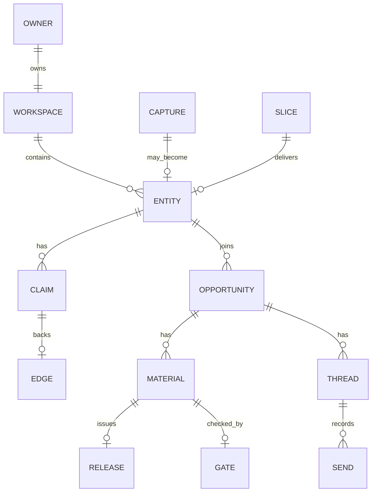

# Documentation index

**Audience:** Contributors and evaluators working in this repository for the first time.
**Purpose:** Locate the owning doc for any topic and fix the vocabulary used in all docs.
**Prerequisites:** Read the root [README](../README.md) for the product pitch.

## How to use these docs

Each topic has exactly one owner.
Other docs link to the owner instead of repeating it.
Use the glossary terms verbatim in code, tests, issues, and docs.
When a term is unavailable, add it here first.

## Docs

| Doc | One-line description | Audience |
|---|---|---|
| [README](../README.md) | Product pitch, features, quick start, screenshot placeholders | New contributors, evaluators |
| [ARCHITECTURE](ARCHITECTURE.md) | Components, data model, trust boundaries, decisions, code limits | Contributors changing behavior |
| [GETTING_STARTED](GETTING_STARTED.md) | Toolchain pins, install, env vars, launch, verification, troubleshooting | New contributors |
| [API](API.md) | Local HTTP contract, auth, endpoint table, errors, versioning | Frontend and service contributors |
| [CONTRIBUTING](CONTRIBUTING.md) | Branching, commits, PR checklist, CI gates, issue reports | Contributors opening PRs |
| [TESTING](TESTING.md) | Test layers, commands, layout, coverage ratchet, examples | Anyone adding or changing tests |
| [OPERATIONS](OPERATIONS.md) | Backup, restore, erasure, migrations, disk hygiene, logs | Contributors changing persistence |
| [CHANGELOG](../CHANGELOG.md) | Version history and Unreleased section | Everyone |
| [CODE_OF_CONDUCT](../CODE_OF_CONDUCT.md) | Expected behavior and enforcement contact | Everyone |

## Glossary

Definitions below are canonical.
Docs in this set use one name per concept.

| Term | Definition |
|---|---|
| **Owner** | The single human user of Parley. Do not write "user" or "customer". |
| **Workspace** | One Owner's local data: a SQLite database, its blob store, and its control directory. Do not write "database" when you mean the whole unit. |
| **Entity** | A canonical typed stored record. Party, Resource, Project, and Capture are kinds of Entity. |
| **Party** | A person or organization the Owner may engage. Do not write "lead" in prose. |
| **Resource** | An Entity describing something the Owner can offer or knows about themselves, such as a proof, gift, artifact, capacity entry, or voice sample. Do not write "asset". |
| **Capture** | Raw, untrusted text the Owner pasted from a source. |
| **Claim** | A factual statement about an Entity, with provenance and immutable revisions. |
| **Edge** | A directed relationship between two Entities, backed by a Claim. |
| **Opportunity** | The Owner's pursuit of a possible exchange. It joins Parties, Resources, and Captures. |
| **Material** | A working output, as copy or a file, bound to one Opportunity and one recipient and held in immutable versions. |
| **Gate** | Deterministic code that decides whether a Material version may be released. No model call runs inside it. |
| **Release** | The authorized issuance of exact Material bytes to a recipient. Write "software version" when you mean a shipped build. |
| **Thread** | The contact conversation for one Opportunity and recipient pair, carrying a reply deadline. |
| **Send** | An Owner-recorded outreach touch on a Thread. It stores exact Material versions and a Gate snapshot. Parley never transmits it. |
| **Slice** | One increment of capability, named S01–S12, P01–P04, or R01–R04, with its own migrations, fixtures, and proof evidence. |

## Term relationships

This diagram shows vocabulary only.
The data model lives in [ARCHITECTURE](ARCHITECTURE.md#data-model).

## Topic ownership

| Topic | Owning doc |
|---|---|
| Product pitch and features | [README](../README.md) |
| Glossary and doc index | This doc |
| Components, diagrams, decisions, code limits | [ARCHITECTURE](ARCHITECTURE.md) |
| Toolchains, env vars, launch, troubleshooting | [GETTING_STARTED](GETTING_STARTED.md) |
| Wire contract and errors | [API](API.md) |
| Branching, commits, PRs, review rules | [CONTRIBUTING](CONTRIBUTING.md) |
| Test layers and coverage | [TESTING](TESTING.md) |
| Backup, restore, erasure, migrations, disk | [OPERATIONS](OPERATIONS.md) |
| Version history | [CHANGELOG](../CHANGELOG.md) |
| Community expectations | [CODE_OF_CONDUCT](../CODE_OF_CONDUCT.md) |
